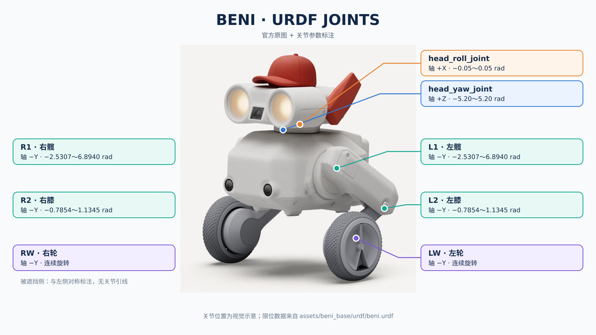
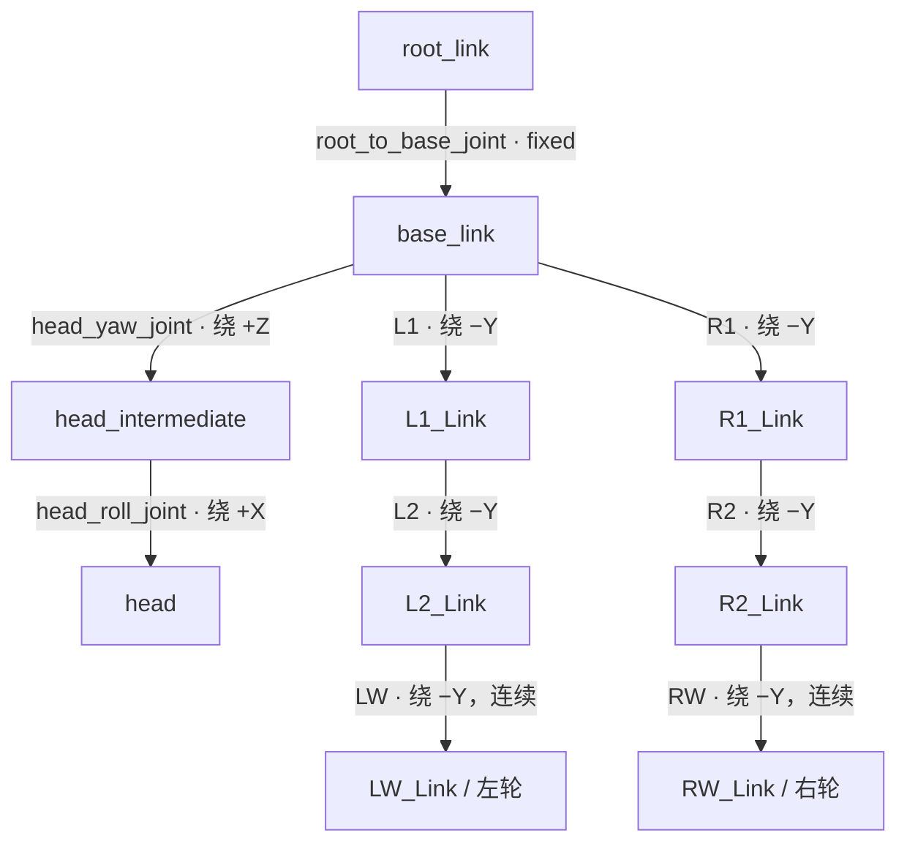

# BENI 机器人 URDF 关节结构

数据来源：[`assets/beni_base/urdf/beni.urdf`](assets/beni_base/urdf/beni.urdf)。下图是**运动学连接示意图**，不按真实外形和尺寸绘制。`L`、`R` 分别为左、右；位置均为关节 `origin xyz`，相对于**父连杆坐标系**，单位 m。全部关节的 `origin rpy` 均为 `(0, 0, 0)`。

图中保留用户提供的官方原图，仅在画布上叠加标注。被遮挡的右侧关节只显示对称参数，不连接到不可见的关节位置。图上的关节定位用于理解结构；精确参数以下方 URDF 参数表为准。

## 关节参数

| 关节 | 类型 | 父连杆 → 子连杆 | 原点 xyz (m) | 轴 xyz | 位置范围 (rad) | effort | velocity (rad/s) |
| --- | --- | --- | --- | --- | --- | ---: | ---: |
| `root_to_base_joint` | fixed | `root_link` → `base_link` | `(0, 0, 0)` | 固定关节，无运动轴 | — | — | — |
| `head_yaw_joint` | revolute | `base_link` → `head_intermediate` | `(0, 0, 0)` | `(0, 0, 1)` | `[-5.20, 5.20]` | 0.1 | 400 |
| `head_roll_joint` | revolute | `head_intermediate` → `head` | `(0, 0, 0.0369)` | `(1, 0, 0)` | `[-0.05, 0.05]` | 1000 | 1000 |
| `L1` | revolute | `base_link` → `L1_Link` | `(0, 0.048, 0)` | `(0, −1, 0)` | `[-2.5307, 6.8940]` | 1.375 | 209 |
| `L2` | revolute | `L1_Link` → `L2_Link` | `(−0.07, 0.024, 0)` | `(0, −1, 0)` | `[−0.785398, 1.134464]` | 3.6 | 149 |
| `LW` | continuous | `L2_Link` → `LW_Link` | `(0, 0.008, −0.075)` | `(0, −1, 0)` | 无位置限位 | 0.6 | 400 |
| `R1` | revolute | `base_link` → `R1_Link` | `(0, −0.048, 0)` | `(0, −1, 0)` | `[-2.5307, 6.8940]` | 1.375 | 209 |
| `R2` | revolute | `R1_Link` → `R2_Link` | `(−0.07, −0.024, 0)` | `(0, −1, 0)` | `[−0.785398, 1.134464]` | 3.6 | 149 |
| `RW` | continuous | `R2_Link` → `RW_Link` | `(0, −0.008, −0.075)` | `(0, −1, 0)` | 无位置限位 | 0.6 | 400 |

`effort` 是 URDF `<limit>` 中的最大关节力/力矩字段：旋转关节通常按 N·m 解读。`velocity` 是 URDF 给出的关节速度上限，不表示策略运行时会达到该速度。`continuous` 关节可持续旋转，因此没有 `lower` / `upper`。固定关节虽然在文件里写了 `<axis xyz="0 0 1"/>`，但该轴不产生运动。文件中的关节没有 `<dynamics>` 或 `<mimic>` 元素。

**坐标说明：**按 ROS 常用机体系解释，`+X` 朝前、`+Y` 朝左、`+Z` 朝上。左髋 `L1` 位于机身 `+Y` 侧 0.048 m，右髋 `R1` 位于 `−Y` 侧 0.048 m。四个腿关节与两个车轮关节都绕局部 `−Y` 轴转动；头部偏航绕 `+Z`，头部侧倾绕 `+X`。这些轴由各自关节坐标系定义；由于此 URDF 的关节 `rpy` 均为零，轴方向与相应父连杆坐标轴对齐。

**与策略的关系：**项目的 7 维策略动作控制 `L1, R1, L2, R2, LW, RW, head_yaw_joint`；`head_roll_joint` 在仿真配置中另有执行器，但不占用策略输出维度。URDF 的 `<limit>` 是模型描述，实际仿真还使用 [`beni_robot.py`](python/beni_rl/beni_robot.py) 中的电机、弹簧、延迟和力矩配置，不能仅凭 URDF 限位推断最终控制能力。
